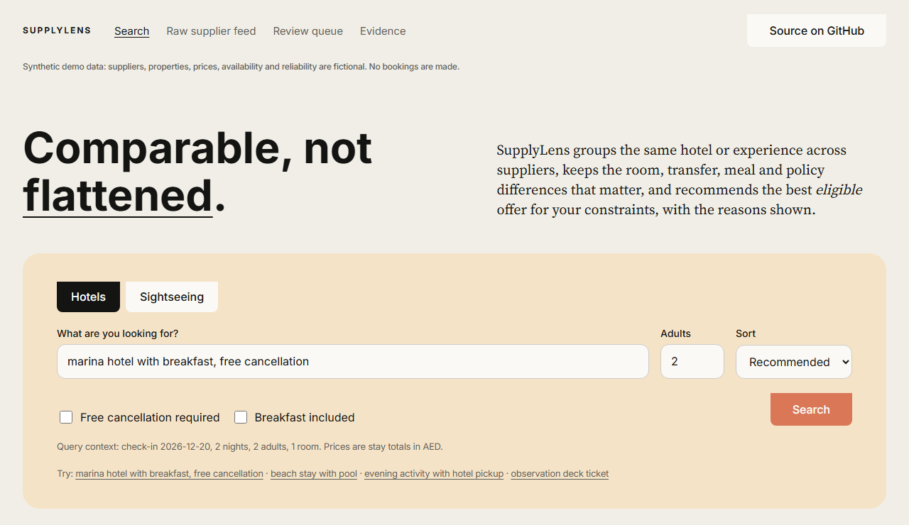
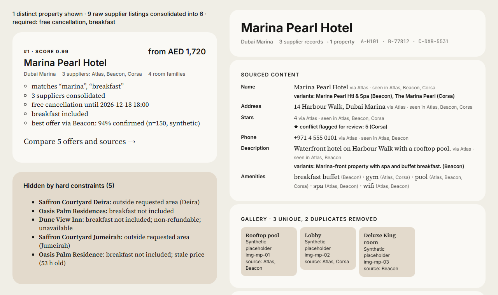
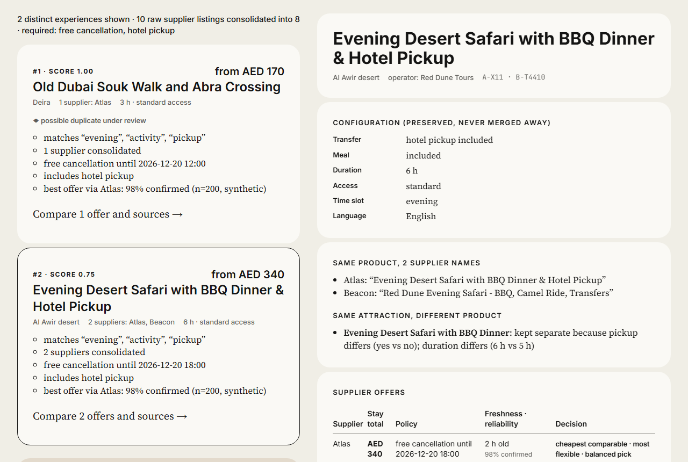
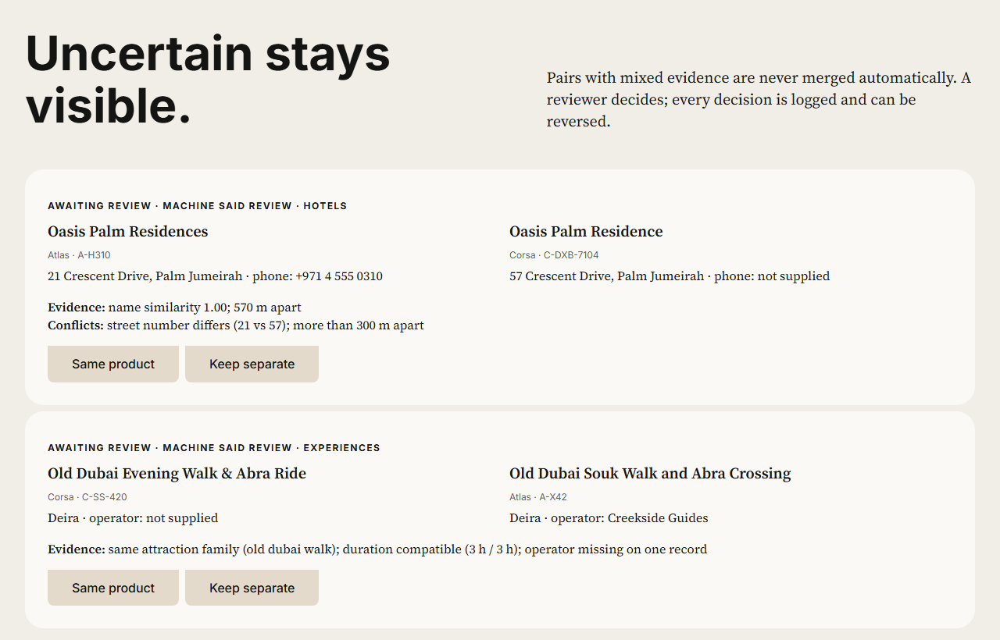
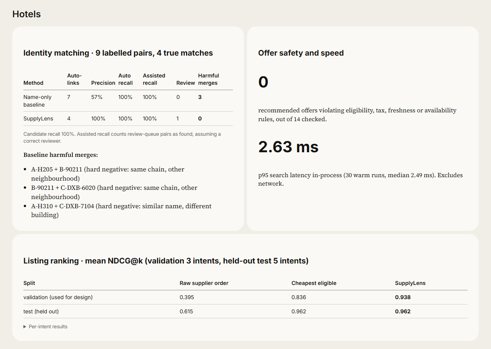
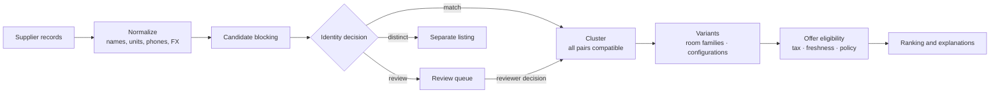

<div align="center">

# SupplyLens

**Multi-supplier inventory for hotels and sightseeing that stays comparable without losing meaningful differences.**

[](https://github.com/gurlivsingh/supplylens/actions/workflows/ci.yml)


[](LICENSE)

[**Live demo**](https://supplylens-alphafire.onrender.com) · [Idea deck](submission/round1/AlphaFire_MultiSupplier_Idea_v2.pdf) · [Idea video](submission/round1/AlphaFire_MultiSupplier_IdeaPitch_v2.mp4) · [Demo video](submission/AlphaFire_MultiSupplier_Demo_v1.mp4) · [Documentation](#documentation)

<sub>Team AlphaFire · TBO VoyageHack 4.0 · Problem statement: Multi Supplier Optimization</sub>

<br>



</div>

---

## Overview

Travel platforms receive the same hotels and experiences from many suppliers. Each supplier uses its own names, units and level of detail. Two things then go wrong. Listing pages fill with duplicates. And naive deduplication merges products that are not the same, such as a tour with hotel pickup and one without, or compares a tax-exclusive price with a full one.

SupplyLens separates three decisions:

| Decision | Question | Outcome |
|---|---|---|
| **Identity** | Are two supplier records the same hotel or experience? | `match` · `review` · `distinct` |
| **Equivalence** | Are two room or activity variants interchangeable? | `equivalent` · `possible` · `distinct` |
| **Recommendation** | Which eligible offer, and which listing, best fits the traveller's request? | Ranked, with visible reasons |

The result is one trustworthy listing per product. Every meaningful option stays inside it, and the recommended offer is the best *eligible* one, not merely the lowest headline price.

> [!NOTE]
> All data is synthetic. Suppliers (Atlas, Beacon, Corsa), properties, operators, prices, availability and reliability are fictional. No bookings are made. See the [data card](docs/DATA_CARD.md).

## Features

**Hotels**
- Consolidates duplicate properties despite abbreviations, prefixes and phone formats, while keeping branches of the same chain separate
- Maps room types by occupancy, bed, size (sqft → m²) and view; a bed "subject to availability" is only a *possible* match
- Merges property content with field-level sources, flags conflicts, and deduplicates images with attribution

**Sightseeing**
- Merges the same operator and itinerary across suppliers
- Keeps look-alikes apart: pickup vs self-transfer, standard vs skip-the-line, with vs without a meal, different operators

**Offers and ranking**
- Eligibility before price: tax-exclusive, stale, unavailable or unknown-policy offers can never be "best"
- Labels within comparable groups: *cheapest comparable*, *most flexible*, *balanced pick*
- Documented ranking score with reasons on every result; a supplier with no history gets a neutral score, not a penalty

**Trust**
- A review queue for uncertain pairs, with reversible decisions and an audit log
- An evaluation tab that recomputes every metric live

<table>
<tr>
<td width="50%"><br><sub><b>Hotels:</b> 3 supplier records become 1 property, with sourced fields and a flagged conflict</sub></td>
<td width="50%"><br><sub><b>Sightseeing:</b> the pickup safari is merged across suppliers; the self-transfer version stays separate</sub></td>
</tr>
<tr>
<td width="50%"><br><sub><b>Review queue:</b> uncertain pairs wait for a person, and every decision is audited</sub></td>
<td width="50%"><br><sub><b>Evidence:</b> baselines vs SupplyLens, per vertical</sub></td>
</tr>
</table>

## Results

Measured on a small, hand-labelled synthetic benchmark. Treat these as exploratory, not as production performance. Full method in the [evaluation report](docs/EVALUATION.md).

| Metric | Hotels | Sightseeing |
|---|:---:|:---:|
| Harmful merges: name-only baseline → SupplyLens | 3 → **0** | 3 → **0** |
| Auto-link precision: baseline → SupplyLens | 57% → **100%** | 40% → **100%** |
| Recall, automatic / with reviewer | 100% / 100% | 67% / 100% |
| Ranking NDCG@k, held out: raw feed / cheapest / SupplyLens | 0.62 / 0.96 / **0.96** | 0.80 / 0.88 / **0.97** |
| Recommended offers breaking eligibility rules | 0 / 14 | 0 / 29 |

## Quick start

Requires Python 3.11 or newer.

```bash
git clone https://github.com/gurlivsingh/supplylens.git
cd supplylens
python -m venv .venv
source .venv/bin/activate          # Windows: .venv\Scripts\activate
pip install -r requirements-dev.txt
uvicorn supplylens.app:app --reload
```

Open <http://localhost:8000>. Interactive API documentation is served at `/docs`.

| Task | Command |
|---|---|
| Run the test suite | `pytest -q` |
| Run the offline evaluation | `python -m supplylens.evaluate` |
| Reset reviewer decisions | Restart the server (state is in memory by design) |

## Guided tour

| # | Scenario | Try this |
|:---:|---|---|
| 1 | Hotel identity and enrichment | Hotels → `marina hotel with breakfast, free cancellation` |
| 2 | Room and policy preservation | Open *Marina Pearl Hotel* → Room mapping |
| 3 | Sightseeing near-duplicate kept apart | Sightseeing → `evening activity with hotel pickup and flexible cancellation` |
| 4 | Cheapest headline price loses | *Marina Pearl Hotel* → Supplier offers (taxes excluded) |
| 5 | Relevance before price | Sightseeing → `dinner cruise` |
| 6 | Uncertainty stays visible | **Review queue** tab, and the "Hidden by hard constraints" list |

A step-by-step script is in the [demo guide](docs/DEMO_GUIDE.md).

## How it works



The ranking score is documented and fixed (master plan §11); it is not learned:

```
score = 0.40·relevance + relevance × (0.25·value + 0.15·policy fit + 0.10·freshness + 0.10·reliability)
```

Requirements stated in the query ("flexible", "breakfast", "pickup", or an area like "marina") become hard filters. Anything filtered out is listed together with the reason.

## API

| Method | Endpoint | Purpose |
|---|---|---|
| `GET` | `/api/search?vertical=hotels&q=…` | Ranked, consolidated results, with hidden items and reasons |
| `GET` | `/api/entity/{vertical}/{id}` | Sourced content, variants and all supplier offers |
| `GET` | `/api/raw/{vertical}` | Baseline: supplier records as delivered |
| `GET` / `POST` | `/api/review` | Review queue and audit log / submit a decision |
| `GET` | `/api/eval` | Live evaluation report |
| `GET` | `/healthz` | Health check |

## Project structure

```
supplylens/
├── supplylens/
│   ├── engine.py        matching, room mapping, enrichment, offers, ranking, review
│   ├── evaluate.py      baselines, NDCG, safety checks, latency
│   └── app.py           FastAPI app and routes
├── web/                 single-page UI (no build step)
├── data/                synthetic fixtures and labels
├── tests/               acceptance tests derived from the master plan
├── docs/                solution note, data card, evaluation, demo guide, risk note
├── submission/          hackathon decks, videos and their build script
└── render.yaml          Render deployment blueprint
```

## Deployment

[](https://render.com/deploy?repo=https://github.com/gurlivsingh/supplylens)

The repository includes a [`render.yaml`](render.yaml) blueprint. No secrets or environment variables are required.

| Setting | Value |
|---|---|
| Build command | `pip install -r requirements.txt` |
| Start command | `uvicorn supplylens.app:app --host 0.0.0.0 --port $PORT` |
| Health check | `/healthz` |

On Render's free plan the service sleeps when idle, so the first request can take 30–50 seconds.

## Documentation

| Document | Contents |
|---|---|
| [Solution note](docs/SOLUTION.md) | How the brief maps to the code, the data model, safety rules, ranking |
| [Data card](docs/DATA_CARD.md) | Origin, counts, deliberate difficulties, labels, limits |
| [Evaluation report](docs/EVALUATION.md) | Baselines, metrics per vertical, observed failures |
| [Demo guide](docs/DEMO_GUIDE.md) | Five-minute walkthrough and expected outcomes |
| [Risk and security note](docs/RISK_SECURITY.md) | Boundaries, input validation, decision risks |
| [Submission package](submission/README.md) | Hackathon decks, videos and upload checklist |

## Limitations

- Synthetic data only. Not validated on real supplier feeds or at scale.
- Relevance is lexical: generic words like "tour" match every listing. Semantic and multilingual matching are future work.
- Reviewer decisions are held in memory without authentication. That is suitable for a demo, not for production.
- No conversion or revenue claims. Those need a controlled pilot with real traffic.

## Team

**Team AlphaFire** · TBO VoyageHack 4.0

AI coding assistance (Claude) was used to write code, documentation and submission material, and the team reviewed the results. Fonts: Inter, Source Serif 4 and JetBrains Mono (SIL Open Font License).

## License

[MIT](LICENSE) © 2026 Team AlphaFire
