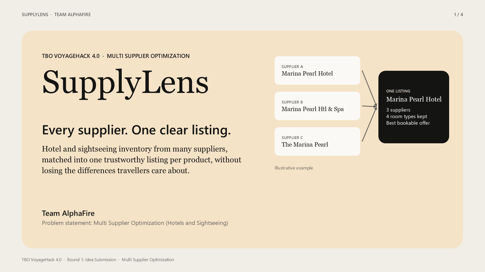
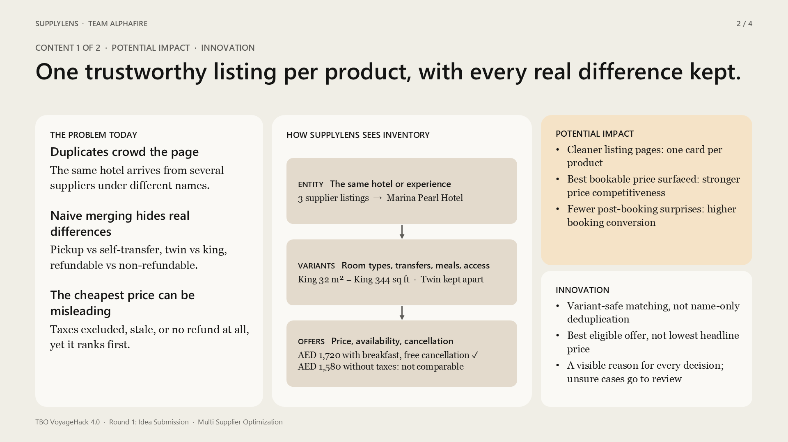
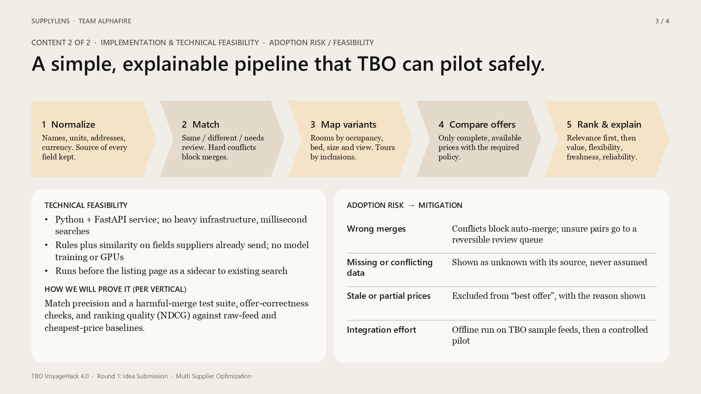
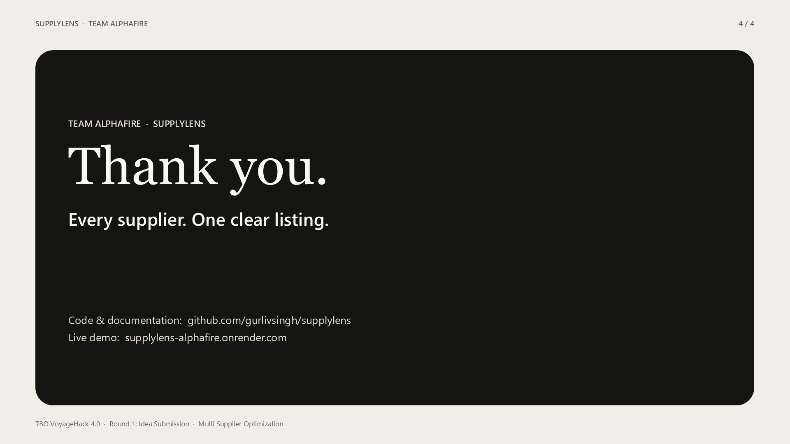

[← Back to README](../README.md)

# Submission package: Team AlphaFire, VoyageHack 4.0

Topic to select on Unstop: **Multi Supplier Optimization**.

## Round 1: Idea submission (deadline 20 Nov 2026, 11:59 PM IST)

The format is a 2-slide PPT, excluding the cover and thank-you slides, plus a video explaining the idea. Files are in [`round1/`](round1/):

| Required | File |
|---|---|
| Presentation (PPTX or PDF) | [`AlphaFire_MultiSupplier_Idea_v2.pptx`](round1/AlphaFire_MultiSupplier_Idea_v2.pptx) · [`.pdf`](round1/AlphaFire_MultiSupplier_Idea_v2.pdf) |
| Video explaining the idea (MP4, 2:55, 1080p) | [`AlphaFire_MultiSupplier_IdeaPitch_v2.mp4`](round1/AlphaFire_MultiSupplier_IdeaPitch_v2.mp4) |

- **Slide 1:** cover.
- **Slide 2:** Potential Impact and Innovation.
- **Slide 3:** Implementation and Technical Feasibility, and Adoption Risk/Feasibility.
- **Slide 4:** thank you.

The PPTX is fully editable, and the narration script is in the speaker notes. Rebuild everything with `python submission/round1/build_round1.py` (needs Windows and PowerPoint).

| Cover | Content 1 | Content 2 | Thank you |
|---|---|---|---|
|  |  |  |  |

## Round 2: Prototype submission (deadline 24 Dec 2026, 11:59 PM IST)

| Required | Where |
|---|---|
| 10-slide presentation | `AlphaFire_MultiSupplier_Prototype_v1.pdf` (or `.pptx`, with the narration in the speaker notes) |
| Functional, well-structured code on GitHub | https://github.com/gurlivsingh/supplylens |
| Detailed documentation for running and understanding the project | `README.md` and `docs/` (solution note, data card, evaluation, demo guide, risk note) |
| Explainer video showing the workflow | `AlphaFire_MultiSupplier_Demo_v1.mp4` |
| Live demo (optional) | https://supplylens-alphafire.onrender.com |

## Before uploading

- [ ] Attend the mandatory webinar (12 Nov) and confirm: video length and size limits, whether slide counts include cover and closing, the GitHub visibility rules, and the rules on AI-tool use and pre-existing work.
- [ ] Watch each MP4 to the end on a second device.
- [ ] Open the PDF and count the slides: Idea has 2 content slides plus cover and thank-you; Prototype has 10 in total.
- [ ] Open the GitHub link in a logged-out browser window.
- [ ] Open the Render link once to wake it up before reviewers do.
- [ ] Save the portal's submission confirmation.

The Round 2 narration uses Windows text-to-speech, and Round 1 uses Microsoft's neural voice (en-IN). If you want your own voices, read the `say` text in `content.py` (it is also in the PPTX speaker notes) and re-record.

## Rebuilding

Start the app (`uvicorn supplylens.app:app --port 8765`), then run `python submission/build.py`. It needs Chrome, Windows, and `pip install python-pptx pillow imageio-ffmpeg`. It recaptures the screenshots from the running app, so the decks always match the code.
